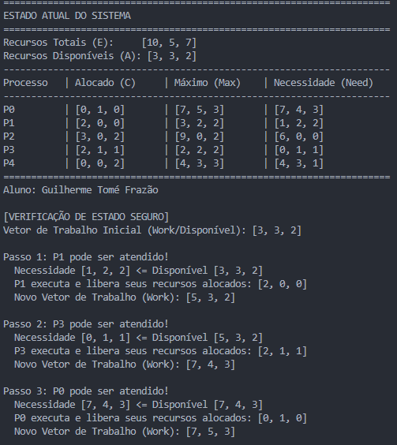
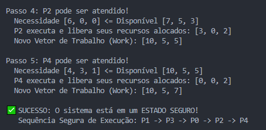
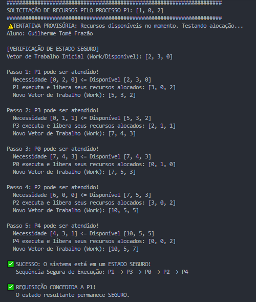
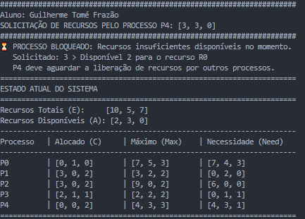

# Atividade 07 — Algoritmo do Banqueiro

**Aluno:** Guilherme Tomé Frazão  
**Disciplina:** Sistemas Operacionais

## 1. Configuração inicial do sistema

O sistema possui cinco processos (P0, P1, P2, P3 e P4) e três tipos de recursos (R0, R1 e R2).

- **Recursos totais (E):** `[10, 5, 7]`
- **Recursos inicialmente disponíveis (A):** `[3, 3, 2]`
- **Necessidade (Need):** `Max - Allocation`

A segurança é verificada procurando uma sequência em que cada processo possa receber os recursos de que ainda necessita, finalizar e devolver os recursos alocados.

## 2. Verificação do estado inicial

**Situação:** antes de qualquer nova solicitação, o algoritmo verifica se os processos conseguem terminar com os recursos disponíveis `[3, 3, 2]`.

**Resultado obtido:** o algoritmo encontrou a sequência segura:

`P1 → P3 → P0 → P2 → P4`

Ao simular a conclusão desses processos, o vetor de trabalho chega a `[10, 5, 7]`, representando a liberação de todos os recursos.

**Conclusão:** o estado inicial é **seguro**, pois existe uma ordem de execução na qual todos os processos podem finalizar.

## 3. Teste 1 — Requisição válida e segura

**Processo solicitante:** P1  
**Requisição:** `[1, 0, 2]`

Inicialmente, P1 ainda necessita de `[1, 2, 2]`, e existem `[3, 3, 2]` recursos disponíveis. Portanto, a solicitação respeita a necessidade declarada e pode ser atendida provisoriamente.

Após a alocação provisória:

- **Disponível (A):** `[2, 3, 0]`
- **Alocado a P1:** `[3, 0, 2]`
- **Necessidade restante de P1:** `[0, 2, 0]`

O algoritmo executa uma nova verificação e encontra a sequência segura:

`P1 → P3 → P0 → P2 → P4`

**Resultado obtido:** `REQUISIÇÃO CONCEDIDA A P1!`

**Conclusão:** a solicitação foi concedida porque havia recursos suficientes e a alocação manteve o sistema em **estado seguro**.

## 4. Teste 2 — Bloqueio por insuficiência de recursos

**Processo solicitante:** P4  
**Requisição:** `[3, 3, 0]`

Depois do Teste 1, o sistema dispõe de `[2, 3, 0]` recursos. A solicitação de P4 está dentro de sua necessidade restante (`[4, 3, 1]`), mas exige **3 unidades de R0**, enquanto apenas **2 unidades de R0** estão disponíveis.

**Resultado obtido:** `PROCESSO BLOQUEADO: Recursos insuficientes disponíveis no momento.`

**Conclusão:** a solicitação não foi concedida; P4 precisa aguardar a liberação de recursos. Como a requisição foi barrada antes de uma alocação provisória, o estado do sistema não foi alterado. Esse teste demonstra **insuficiência de recursos**, não uma reprovação na verificação de estado seguro.

## 6. Conclusão geral

A execução demonstrou como o Algoritmo do Banqueiro avalia solicitações para preservar a segurança do sistema. O estado inicial era seguro; a requisição de P1 foi concedida porque o estado continuou seguro; e a requisição de P4 foi bloqueada pela falta de recursos disponíveis. Assim, o algoritmo contribui para a prevenção de *deadlocks*, evitando alocações que comprometam a possibilidade de conclusão de todos os processos.